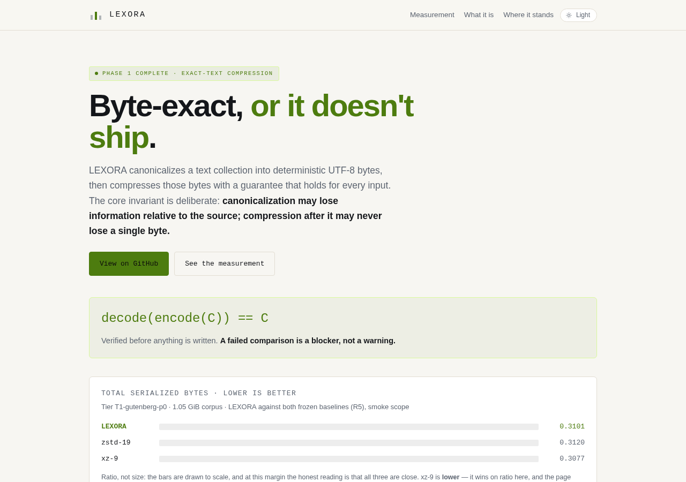

<div align="center">

<h1>LEXORA</h1>

<p><b>Layered EXact-text Repository &amp; Adaptive compression architecture</b><br>
Canonicalize text conservatively, then compress it with guaranteed byte-exact recovery — <code>decode(encode(C)) == C</code> for every input.</p>

<p>
<a href="https://drsamonline.github.io/lexora/"></a>
<a href="https://github.com/drsamonline/lexora/actions/workflows/ci.yml"></a>

<a href="LICENSE"></a>

</p>

<p>
<a href="https://drsamonline.github.io/lexora/"><b>Landing page</b></a> &nbsp;·&nbsp;
<a href="https://drsamonline.github.io/lexora/#start">Install from source</a> &nbsp;·&nbsp;
<a href="https://drsamonline.github.io/lexora/#benchmarks">Benchmarks</a> &nbsp;·&nbsp;
<a href="https://drsamonline.github.io/lexora/#faq">FAQ</a> &nbsp;·&nbsp;
<a href="docs/PATH_TO_V1.md">Roadmap to v1.0</a> &nbsp;·&nbsp;
<a href="docs/STATUS.md">Status</a> &nbsp;·&nbsp;
<a href="https://github.com/drsamonline/lexora">Repository</a> &nbsp;·&nbsp;
<a href="https://drsamonline.github.io/">All projects</a>
</p>

<p><sub>Phase 1 prototype — no releases and no stable API yet; install from a source checkout. PolyForm Noncommercial 1.0.0 © 2026 Dr. Sohil Momin.</sub></p>

</div>

---

> **Project status: Phase 1 prototype in development.** Documentation (Batches A–E) complete/drafted;
> early implementation code exists (canonicalization, Zstd core baseline, `.lxz` v0 container, benchmark harness,
> CLI app, experimental PySide6 GUI milestones M1–M3).
> Nothing here is a shipped or released feature. See [docs/STATUS.md](docs/STATUS.md) for the verified state.
> **Badge honesty note:** the CI badge reflects the real workflow in `.github/workflows/ci.yml`, but
> **GitHub Actions runs have resumed** — they were paused by owner decision 2026-10-17 (OQ-15, free-tier minutes) and this note outlived the pause: `ci.yml` ran green on `main` on 2026-11-13 and 2026-11-15. Historical note follows —
> the badge shows the last historical run, not current state; verification gate is local (`pytest -q` + linkcheck
> before every commit). The *Tests* badge is a
> static snapshot of the locally verified suite (101 passed, re-verified 2026-10-17), not a live measurement.
> **Last verified:** 2026-10-17 against the current working branch (see git history).

---

## What is LEXORA?

LEXORA is a text-cleaning and **exact-compression** system for document collections (TXT, PDF, optionally OCR'd scans). It:

1. **Ingests** TXT and PDF files (OCR optional for scanned pages).
2. **Canonicalizes** the extracted text conservatively into deterministic UTF-8 bytes (this step *may* be lossy relative to the source, by design).
3. **Compresses** those canonical bytes with **guaranteed byte-exact recovery**: `decode(encode(C)) == C` for every input.

The core invariant: **canonicalization may lose information relative to the original source; compression after canonicalization must never lose a single byte.**

## Why?

Generic compressors (Zstandard, XZ, Brotli) treat text as opaque bytes. Document collections contain structure — repeated boilerplate, templates, records, multilingual text (English, Hindi, Gujarati) — that a compressor can exploit if it is allowed to *learn* representations safely. LEXORA's goal is to beat frozen generic baselines on total stored size while preserving strict correctness and running on low-resource hardware (~4 GiB RAM).

## Goals

- Byte-exact losslessness after canonicalization — always, provably, via round-trip verification.
- Conservative, versioned canonicalization with golden test vectors.
- Cost-driven codec/candidate selection: every candidate competes against pinned baselines, and **every serialized byte counts** in the cost model.
- Operate within a ~4 GiB RAM budget with bounded, streaming/block-based processing.
- Multilingual support through plugins: **English, Hindi (Devanagari) and Chinese ship
  today** as separate distributions behind one seam ([ADR-0022](docs/ADR/ADR-0022-language-plugins.md)).
  Gujarati is designed for and not yet built.

## Non-goals (current scope)

- Reconstructing original OCR output or source PDF layout bit-for-bit.
- Claiming any performance advantage over Zstd/Brotli/XZ/PPMd before reproducible benchmark evidence exists **at protocol scope**. R6 is protocol-*shaped* — 3 splits, 3 reps, 6 systems, leak audit clean — but at 5.9 MB rather than the 1.054 GiB corpus, so its CHCE figure is labelled as such and gate **G2 is still open** ([docs/BENCHMARK_RESULTS.md](docs/BENCHMARK_RESULTS.md), [PATH_TO_V1](docs/PATH_TO_V1.md) P0). No ratio is published as a result.
- Being a general-purpose archive format.

## Features by maturity

| Status | Capability |
|---|---|
| **Implemented** | Conservative canonicalizer (`src/lexora/canonicalize.py`), Zstd core baseline (`src/lexora/zstd_core.py`), `.lxz` v0 container (`src/lexora/container.py`, ADR-0007), **TXT and PDF text-layer ingestion** with provenance per document (ADR-0017), **OCR as an external Tesseract plugin** (ADR-0019), the **queryable archive** (`lexora db` — a SQLite sidecar index over `.lxz` payloads, ADR-0016; schema v3 with the tokenizer recorded per ADR-0024 and a `doc_grams` index that answers 1–2 character CJK queries), **three language plugins** (English, Hindi `hi-1`, Chinese `zh-1`) selectable with `--language`, a **GUI query view that is a client of the CLI** (ADR-0011, offscreen-tested), the benchmark harness (`benchmarks/harness.py` + `corpus.py`, reproducible per [benchmarks/README.md](benchmarks/README.md)), and **eleven subcommands** (see [docs/CLI_REFERENCE.md](docs/CLI_REFERENCE.md)). **Every core path streams** — encode, decode and canonicalization are flat in document size (measured: 126 MiB / 35 MiB / 35 MiB peak). The live test count is the CI badge; the local count and the date it was measured are in [docs/STATUS.md](docs/STATUS.md) |
| **In progress** | **Gate G2, the protocol-scope benchmark** — the one unmet release precondition. R6 already reproduces across splits and reps, but at 5.9 MB instead of the 1.054 GiB corpus, on one machine class, without the `xz` CLI and without the `ppmd-7z` row ([PATH_TO_V1](docs/PATH_TO_V1.md) P0). The corpus **meets** the ≥1 GiB requirement (2395 files / 1.054 GiB, OQ-8). The `doc_grams` table that answers short CJK queries costs ~5× the stored payload — stated, not hidden. GitHub Actions run on every push |
| **Planned** | `.lxdb`, the single queryable file ([ADR-0013](docs/ADR/ADR-0013-lxdb-layout.md), Proposed, gated on G2); the optional encryption profile ([docs/ENCRYPTION_PROFILE.md](docs/ENCRYPTION_PROFILE.md), Proposed); the cleaning-error metric operationalised (REQ-CAN-007, ADR-0004); a packed-hash form of the `doc_grams` table; GUI stretch items (batch queue, drag-and-drop, shortcuts) |

## Architecture overview (proposed)

```
TXT/PDF ──▶ Extraction (optional OCR) ──▶ Canonicalization (versioned, deterministic)
        ──▶ Compression (byte-exact, cost-selected codec) ──▶ .lxz archive (.lxdb later)
        ◀── decode ◀── verify: decode(encode(C)) == C enforced at build time
```

A normative specification (`docs/SPECIFICATION.md`) and detailed architecture documents exist as drafts (Batch B). To contribute, see [CONTRIBUTING.md](CONTRIBUTING.md); the release process is documented in `docs/RELEASE_PROCESS.md` (two alpha releases are tagged — `v0.1.0-alpha.1` and `v0.2.0-alpha.1` — both **not for production data**).

## Supported inputs & current limitations

- **Design targets:** `.txt` (UTF-8/other encodings), `.pdf` (text-layer first; OCR for scanned pages), scripts: Latin, Devanagari, Han (Chinese); Gujarati designed for, not built.
- **Current reality:** TXT and PDF text-layer ingestion are implemented (`src/lexora/ingest.py`, ADR-0017 — page order preserved, `mode`/`engine`/`pages`/`text_sha256` stored per REQ-ING-004); scanned pages can be OCR'd through an external Tesseract binary (ADR-0019); English, Hindi and Chinese are selectable on the CLI (`--language hi|zh`, P3.6). Three limits are stated rather than hidden: OCR accuracy has never been checked against a human transcript; a query shorter than three characters in Chinese is answered from a bigram index that costs ~5× the stored payload; and a plugin path buffers instead of streaming, because a plugin declares a whole-document `canonicalize`.

## Installation / Quick start

Install from a source checkout (no published package exists):

```bash
pip install -e .            # core (Qt-free): zstandard pinned range, Python >=3.12,<4.0
pip install -e ".[dev]"     # + pytest for the test suite
pip install -e ".[gui]"     # + PySide6 for the experimental GUI (opt-in extra, ADR-0008)
```

Then try the CLI — `lexora --help` for the eleven subcommands, all documented in [docs/CLI_REFERENCE.md](docs/CLI_REFERENCE.md):

```bash
lexora doctor                                    # install health, incl. a live round-trip self-test
printf 'alpha\r\nbeta\r\n' > in.txt
lexora canon --in in.txt --out canon.txt
lexora pack  --in canon.txt --out a.lxz          # default zstd level 9 (ADR-0012)
lexora verify  --in a.lxz                        # audit: structure + every block's SHA-256
lexora inspect --in a.lxz --verify               # readable summary + accounting identity
lexora unpack  --in a.lxz --out back.txt
lexora batch   --in DIR --out-dir OUT --op canon  # a whole tree, per-file JSON report
lexora zdecode --in frame.bin --out back.txt     # raw zstd frame, the mirror of zround
```

### Query it like a database

The archive is also a **searchable, compressed store** — SQLite holds the index, lexora holds
the compressed text, and only the documents you ask for get decoded:

```bash
lexora db init  --root myarchive
lexora db add   --root myarchive --in book.txt --path "books/book.txt" --meta lang=en
lexora db add   --root myarchive --in paper.pdf --path "papers/paper.pdf"   # PDF text layer
lexora db add   --root myarchive --in scan.pdf  --path "scans/scan.pdf" --ocr  # scanned
lexora db search --root myarchive --query whale --filter lang=en
lexora db get   --root myarchive "books/book.txt" --out back.txt
```

Measured on 19 Gutenberg books (19.4 MB): payload **6.5 MB** (ratio 0.335), index **7.6 %** of
the text, query **0.34 s**, single-document retrieval **0.47 s**. Design and trade-offs:
[ADR-0016](docs/ADR/ADR-0016-queryable-archive.md) · usage: [docs/QUERY_ARCHIVE.md](docs/QUERY_ARCHIVE.md).

There is a GUI for it: `lexora-gui`, then **Query archive…** in the ribbon.

The GUI launcher `lexora-gui` requires the `[gui]` extra and exits 2 with guidance without it.

## Build & test commands

Verified in-container (2026-10-29):

```bash
pip install -e .                         # required: the GUI service spawns `python3 -m lexora.cli`
export LEXORA_ZIPTASTIC=/path/to/ziptastic   # required for the codec adapter tests
python3 -m pytest -q                     # 716 passed, 13 skipped (3m 38s; includes fuzz + interruption suites)
QT_QPA_PLATFORM=offscreen python3 -m pytest -q   # same, incl. offscreen GUI widget tests (needs pyside6 + libegl1)
python3 scripts/linkcheck.py             # docs integrity gate — ALL INTERNAL LINKS OK
```

**The two prerequisites are not optional, and the numbers above only hold with them.** Without
`pip install -e .` the GUI service tests fail 29 at a time with `No module named 'lexora'` — the
service spawns a subprocess, and a subprocess does not inherit `sys.path`. Without
`$LEXORA_ZIPTASTIC` the adapter tests skip. Both were missing from this list until 2026-11-18,
which is why the count here said 492 when the suite had grown to 716.

The count depends on what is installed, and every number is real: **716 passed, 13 skipped** on a
bare checkout with the two prerequisites above, and **773 passed, 12 skipped** in CI, which also
installs PySide6 and `lexora-lang-hi`.

**Neither number is quoted as a target.** Both changed inside one day — CI read 743/11 this morning
and 773/12 by the afternoon, with no code change between them, because a conditional install
succeeded on the second run. Read the current figure from the CI log; treat these as examples of the
two environments rather than as the suite's size. Each skip says which extra it wants: 10 need
`lexora-lang-hi` (`pip install -e packages/lexora-lang-hi`), 1 PySide6, 1 the `[gui]` extra, and 1
is the real-binary throughput check (ADR-0014).

## Benchmarks

**LEXORA has now been measured against both frozen baselines — at smoke scope, not verdict scope.** The acceptance gates are defined in the blueprint (Pass ≥ 10%, Partial ≥ 3% smaller total stored size vs. the best frozen baseline) and formalized in `docs/BENCHMARK_PROTOCOL.md`.

R4, three splits, 172 files / 78.6 MiB, 3 reps (draft, awaiting owner review):

| system | ratio |
|---|---|
| `lexora` (shipped default, level 9) | 0.3352 |
| `lexora19` | **0.3090** |
| `zstd19` (baseline) | 0.3109 |
| `xz9` (baseline) | **0.3068** |

So the pipeline sits **between** the two baselines: a small, consistent advantage over zstd-19 (167 of 172 files smaller) and a small, consistent deficit against xz-9 (xz wins every file). **Neither is a gate verdict**: the corpus now meets the ≥1 GiB requirement but no protocol-scope run has been done, and the honest reading is in [docs/R4_SMOKE_DRAFT.md](docs/R4_SMOKE_DRAFT.md). Reproduce it from [benchmarks/README.md](benchmarks/README.md).

## Security & privacy notes

- No security guarantees are claimed and no formal review has been performed.
- **What is tested:** deterministic fuzz suites throw truncations, byte flips, end-drops and random blobs at seven reader entry points and assert that every mutant either decodes to the original bytes or raises `ContainerError` — never another exception and never a wrong answer; the reader enforces absolute limits (LIM-01/LIM-02) rather than trusting a header's declared caps; the atomic-write guarantee is verified against real SIGINT/SIGTERM/SIGKILL.
- Design intent: decoders enforce resource limits (bounded blocks, memory caps) to survive hostile archives; sensitive/clinical corpora must not train shared dictionaries by default.
- Vulnerability reporting instructions live in [SECURITY.md](SECURITY.md).

## Documentation index

- [docs/RELEASE_NOTES.md](docs/RELEASE_NOTES.md) — what this unreleased tree contains, its limits, and what a release would need
- [benchmarks/README.md](benchmarks/README.md) — reproduce every measurement from a clean checkout
- [docs/R4_SMOKE_DRAFT.md](docs/R4_SMOKE_DRAFT.md) — LEXORA vs both baselines, and what the numbers do not say
- [docs/DEPENDENCY_LICENCE_REVIEW.md](docs/DEPENDENCY_LICENCE_REVIEW.md) — third-party obligations under PolyForm

Start at **[docs/index.md](docs/index.md)**. Key entry points:

| Document | Purpose |
|---|---|
| [docs/STATUS.md](docs/STATUS.md) | Current verified project state |
| [docs/NEXT_SESSION.md](docs/NEXT_SESSION.md) | Resume card for the next work session |
| [docs/PROJECT_CHARTER.md](docs/PROJECT_CHARTER.md) | Problem, scope, constraints, success criteria |
| [docs/PRODUCT_REQUIREMENTS.md](docs/PRODUCT_REQUIREMENTS.md) | Numbered requirements (`REQ-*`) |
| [docs/GLOSSARY.md](docs/GLOSSARY.md) | Terminology |
| [docs/DECISIONS.md](docs/DECISIONS.md) | ADR index & open decisions |
| [CONTRIBUTING.md](CONTRIBUTING.md) | Ground rules, workflow, PR guidance |
| [CHANGELOG.md](CHANGELOG.md) | Change history |
| [LEXORA_Full_Blueprint_Design_Master_Prompt.md](LEXORA_Full_Blueprint_Design_Master_Prompt.md) | Approved master design blueprint (source of truth) |

## Roadmap (summary)

1. **Phase 0 (complete):** Documentation foundation, canonicalization decisions & test vectors, open conflicts resolved via delegated ADRs.
2. **Phase 1 (current):** Core Zstandard baseline + corpus manifest + benchmark harness — code landed; closure evidence awaiting owner verdict. GUI milestones M1–M3 landed experimentally alongside.
3. **Phase 2:** Ingestion & canonicalization with golden vectors.
4. **Phase 3+:** Experimental candidates, `.lxz` format freeze, `.lxdb`, optional encryption — each gated by measured evidence.

Details in `docs/ROADMAP.md` (Batch C).

<!-- support:sweep -->
## Support

| | |
|---|---|
| UPI (India) | `drsohilboi@ybl` — payee Dr Sohil Momin, open amount, or scan [the QR](docs/assets/upi-qr.svg) |
| GitHub Sponsors | [github.com/sponsors/drsamonline](https://github.com/sponsors/drsamonline) |
| Ko-fi | [ko-fi.com/matneo](https://ko-fi.com/matneo) |
| PayPal | [paypal.me/drsohilmomin](https://paypal.me/drsohilmomin?locale.x=en_GB&country.x=IN) |
| My books | [Amazon author store](https://www.amazon.com/stores/author/B08ZT331LY/allbooks?ccs_id=aed72b9f-71d9-41dc-adee-e9368a317acc) |
| More apps | [drsamonline.github.io](https://drsamonline.github.io/) |
| Email | [sohilmomin2000@gmail.com](mailto:sohilmomin2000@gmail.com) |

## License

**PolyForm Noncommercial 1.0.0** © 2026 Dr. Sohil Momin — see [LICENSE](LICENSE), which is normative and includes the `Required Notice:` line that must travel with every copy.

This is a **source-available, noncommercial** licence, not an OSI-approved open-source licence: you may read, run, change and share the software for any noncommercial purpose (personal use, research, study, charities, educational institutions, public research and government bodies), but commercial use needs a separate licence from the owner. Chosen by the owner on 2026-10-29 ([ADR-0009](docs/ADR/ADR-0009-license-polyform-noncommercial.md)), superseding the earlier MIT decision ([ADR-0006](docs/ADR/ADR-0006-license-mit.md), now superseded). The SPDX identifier declared in `pyproject.toml` is `PolyForm-Noncommercial-1.0.0`.

## Project owner

Dr. Sohil Momin.

---

*This README's badges are backed by real artifacts: the CI badge points to `.github/workflows/ci.yml`,
the License badge to [LICENSE](LICENSE), and the Python badge to `requires-python` in `pyproject.toml`.
No coverage, release, or download badges exist — those claims are not yet true. Badges will be removed
or corrected if the underlying workflows/services are removed or fail.*
