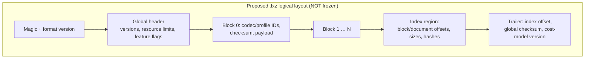

# `.lxz` Container Format

> ## ⚠️ v0 EXPERIMENTAL — layout frozen by ADR, pre-release
> **Status (updated Session 24; re-verified Session 26):** The freeze gate below was satisfied by accepted [ADR-0007](ADR/ADR-0007-container-v0-freeze.md) (owner delegation, incl. three recorded amendments that supersede earlier draft numbers: 128-byte header / full 32-byte header checksum, 56-byte index entries, 40-byte trailer with 24-byte index-digest prefix). The **implemented** layout lives in `src/lexora/container.py` and is locked by golden vectors under `tests/vectors/lxz_format/`; the requirements table below remains valid. Format major is still **0**: byte compatibility across revisions is NOT promised until a 1.x ADR (COMPATIBILITY_POLICY). Do not treat v0 archives as long-lived artifacts.
> **Owner:** Unassigned
> **Last verified:** 2026-10-17 (Session 26)
> **Related:** [SPECIFICATION.md §7](SPECIFICATION.md) · REQ-FMT-001…003 · [COST_MODEL.md](COST_MODEL.md)

## Purpose & Scope

Records the *requirements* the eventual `.lxz` format must satisfy, plus high-level structural ideas under discussion. Freezing the layout requires: accepted format ADR + committed test vectors (blueprint Phase 4; `.lxdb` remains deferred until this is validated — REQ-FMT-004). **Gate status:** both conditions met for v0 via ADR-0007 + lxz golden vectors (Sessions 24–26); `.lxdb` deferral stands.

## Required elements (from SPEC §7.1 — these are requirements, not layouts)

| Element | Requirement | Notes |
|---|---|---|
| Magic bytes | Unambiguous identification; early rejection of wrong files | Value TBD by format ADR |
| Format version | Major/minor semantics per COMPATIBILITY_POLICY (Batch D) | |
| Codec + profile IDs | Registry-managed; retired IDs never reused | See COMPRESSION_ARCHITECTURE |
| Canonicalizer + tokenizer versions | Recorded; checked at verify time | REQ-CAN-004 |
| Checksums | Detect corruption ⇒ refuse decode explicitly | REQ-SEC-004 |
| Length-before-allocation | All length fields validated against declared resource limits before buffering | REQ-SEC-001 |
| Block index | Enables bounded single-document decode without whole-archive load | REQ-CMP-005 |
| Resource-limit declarations | Max block/dictionary sizes enforced by decoder | REQ-FMT-002 |
| Feature flags | must-understand vs may-ignore bits | REQ-FMT-003 |
| Provenance metadata | Source file, extraction mode, engine/version per document | REQ-ING-004 |
| Dictionary references | (ID, SHA-256, dict-format-version); hash verified before use | SPEC §6.1 |

## Structural sketch (discussion level only — explicitly non-normative)

Index-at-trailer vs. streaming-first design is an open trade-off (random access vs. append-only writing); unresolved.

## Unknown-feature behavior (normative intent)

- Unknown **may-ignore** flag ⇒ proceed, report.
- Unknown **must-understand** flag, unknown codec ID, or unsupported version ⇒ hard refusal with specific error code; zero output bytes. Partial/garbage output forbidden (`REQ-CMP-006`).

## Corruption handling intent

Checksum mismatch ⇒ affected block refused; other independent blocks MAY still decode if archive integrity permits (granularity decision pending format ADR).

## Test vectors

Required before freeze; none exist. Planned location `tests/vectors/lxz_format/`.

## What would make this document real

1. Accepted ADR defining exact byte layout + registry values.
2. Committed golden archives + conformance suite (REQ-FMT-001 evidence).
3. Version identifier assigned (e.g., LXZ-0.1-draft → LXZ-1.0).
