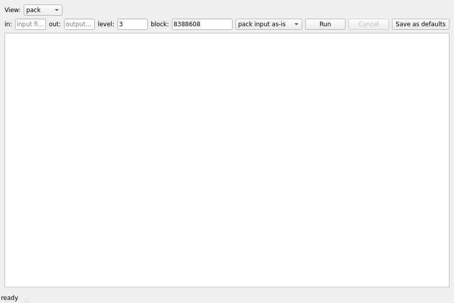
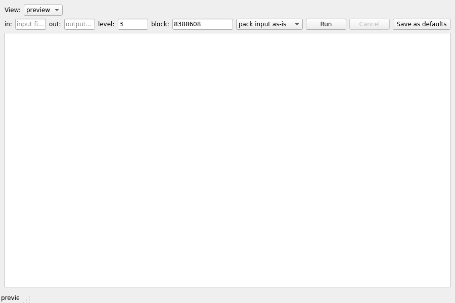

# LEXORA GUI — screenshots (GUI-M2c)

Generated headlessly by `scripts/gen_screenshots.py` (Qt offscreen platform,
no display required; regenerate with `python3 scripts/gen_screenshots.py`).
These are real renders of the shipped window (`lexora.gui.app.build_window()`),
not mockups.

## Main window (pack view, default)

The G1 shell: view selector (G2 pack / G3 unpack / G4 inspect / G5 preview),
file form with level + block-size fields pre-filled from **G7 persisted
defaults**, Run/Cancel (async via `JobRunner`, GUI-M2), "Save as defaults"
(G7), progress bar, and the append-only diagnostics pane (G6).

## Preview view

G5 selected: canonicalized-text feed with audit header (canonicalizer
version, applied rules, input/output byte+SHA stats) rendered through the
pure Qt-free `format_preview_text`.

Notes:
- Renders come from a Debian 12 container using the Fusion-less default Qt
  style under `QT_QPA_PLATFORM=offscreen`; desktop themes will look slightly
  different — that is cosmetic only.
- Screenshots must be regenerated whenever `build_window()` layout changes;
  stale images are a docs bug (linkcheck can't catch it — visual review does).
