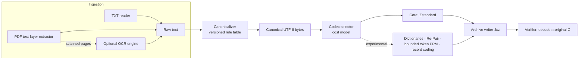

# LEXORA Master Blueprint (Distilled)

> **Status:** Approved design summary — derived from, and subordinate to, the source-of-truth file
> **Owner:** Unassigned
> **Last verified:** 2026-10-15 against `LEXORA_Full_Blueprint_Design_Master_Prompt.md` @ commit `816f58f`
> **Related:** [Source blueprint](../LEXORA_Full_Blueprint_Design_Master_Prompt.md) · [SPECIFICATION.md](SPECIFICATION.md) · [DECISIONS.md](DECISIONS.md)

## Purpose & Scope

This document distills the broad architecture, rationale, phases, module boundaries, and alternatives from the full master blueprint so engineers can navigate it. **It is not normative.** Where this summary and the source blueprint differ, the source blueprint wins (see hierarchy in [DECISIONS.md](DECISIONS.md)). Exact testable behavior belongs to [SPECIFICATION.md](SPECIFICATION.md).

## What LEXORA Is

LEXORA (**Layered EXact-text repository with adaptive compression**) ingests TXT and PDF files, optionally OCRs scanned pages, applies *conservative* canonicalization to produce versioned UTF-8 bytes, then compresses those bytes with **exact byte-for-byte recovery**: `decode(encode(C)) == C`.

The central design separation:

```text
Source ──extract──▶ Raw text ──canonicalize──▶ Canonical bytes C ──compress──▶ Archive
        (may lose fidelity vs. source)      (lossy vs. raw, deterministic,   (LOSSLESS — never
                                             versioned, rule-table-bounded)    loses a single byte of C)
```

- Canonicalization **may** be lossy relative to the original source/OCR output.
- Compression after canonicalization **must** be strictly lossless. Original source recovery is explicitly **not** a goal.

## Design Rationale (why these choices)

| Choice | Rationale (blueprint §) |
|---|---|
| Byte-exact contract on canonical bytes | Verifiable; separates "cleaning quality" questions from "data-loss" questions (§4, §7) |
| Conservative, whitelisted cleaning rules | Silent corruption is the primary risk; every rule must be listed, versioned, and tested (§6) |
| Zstandard as Core baseline | Fast, streaming, low-memory, strong default; mature Python binding (§8) |
| Cost-driven candidate selection | Experimental codecs earn their serialized overhead; every header/side-table/dictionary byte counts (§9–§10) |
| Frozen baselines + gates | No performance claims without reproducible evidence: Zstd-19, Brotli q11, XZ, PPMd; Pass ≥10%, Partial ≥3% (§12; gate scope under ADR-0001) |
| Lineage-split corpus (70/10/20) | Prevents leakage: dictionaries/grammars induced only from training split (§12) |
| Bounded blocks / streaming decode | ~4 GiB RAM target; decode one document without loading whole archive (§5, §13) |

## System Context & Module Boundaries (proposed)



Modules (planned boundaries, no code exists yet):

1. **Ingestion** — encoding detection, PDF page-order extraction, optional OCR with graceful skip when unavailable (REQ-ING-*).
2. **Canonicalization** — deterministic rule engine, version identifier, script-safety for Devanagari/Gujarati combining marks (REQ-CAN-*). Detail: [CANONICALIZATION.md](CANONICALIZATION.md).
3. **Tokenizer/candidate layer** — token boundaries and literal fallback for experimental candidates. Detail: [TOKENIZER_SPEC.md](TOKENIZER_SPEC.md).
4. **Compression core** — Zstd profiles; block policy; bounded memory (REQ-CMP-*). Detail: [COMPRESSION_ARCHITECTURE.md](COMPRESSION_ARCHITECTURE.md).
5. **Cost model & selection** — serialized-byte accounting; reproducible selection (REQ-CMP-003/004). Detail: [COST_MODEL.md](COST_MODEL.md).
6. **Container/format** — `.lxz` magic, versions, checksums, indexes, resource limits (REQ-FMT-*). Detail: [FORMAT_LXZ.md](FORMAT_LXZ.md) — **layout NOT frozen**.
7. **Verification/recovery** — round-trip check on 100% of archived content; corruption refusal semantics (REQ-SEC-004, REQ-CMP-006).
8. **Benchmark harness** — corpus manifest, splits, pinned baselines, per-category reporting (REQ-BMK-*).

## Phases (overview — see PROGRESS.md for live status)

| Phase | Objective | Exit evidence |
|---|---|---|
| 0 | Governance freeze: canonicalization decisions, rule table, test vectors, ADRs accepted | Accepted ADRs; golden vectors committed |
| 1 | Core pipeline: ingest → canonicalize → Zstd → verify, CLI prototype | Round-trip tests green on fixtures |
| 2 | Benchmark harness + frozen corpus + baselines | First validated BENCHMARK_RESULTS run |
| 3 | Optional candidates under promotion gate (dictionaries first) | Ablation reports; gate verdicts |
| 4 | `.lxz` format freeze; hardening, fuzzing, limits | Format conformance suite; fuzz runs |
| 5 | `.lxdb` incremental database mode (deferred until .lxz validated) | Separate spec cycle |

## Alternatives Considered (recorded in blueprint; ADR-worthy before adoption)

- Lossless-vs-source architecture (storing raw OCR output + diff): rejected — blows size budget, conflicts with stated goal.
- Unicode-normalization-heavy cleaning (NFKC etc.): deferred — too aggressive for conservative rule table; per-rule ADR required.
- ML-based compression: out of scope for 4 GiB prototype budget.

## Known Conflicts in the Source Blueprint (open)

Four internal conflicts are tracked as proposed ADRs — do **not** treat any resolution below as approved until the ADR status changes to Accepted:

1. Gate granularity → [ADR-0001](ADR/ADR-0001-gate-scope.md)
2. Brotli role → [ADR-0002](ADR/ADR-0002-brotli-role.md)
3. PPMd role → [ADR-0003](ADR/ADR-0003-ppmd-role.md)
4. Cleaning-error metric → [ADR-0004](ADR/ADR-0004-cleaning-error-metric.md)

Index: [DECISIONS.md](DECISIONS.md).

## Status and open decisions

- Architecture direction: stable (matches owner-approved blueprint).
- Module boundaries: proposed; will be restated normatively in SPECIFICATION.md once OQ-1…OQ-4 are accepted.
- No implementation exists; nothing here has been measured.
