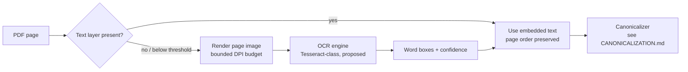

# OCR Pipeline

> **Status:** Proposed (no code; engine/version unpinned — OQ-10)
> **Owner:** Unassigned
> **Last verified:** 2026-10-15
> **Related:** [SPECIFICATION.md §2.6](SPECIFICATION.md) · [CANONICALIZATION.md](CANONICALIZATION.md) · REQ-ING-003, REQ-CAN-006

## Purpose & Scope

How scanned PDF pages become raw text that enters canonicalization. OCR is **optional**: the pipeline MUST run with no OCR engine installed (graceful skip + clear report per page).

## Flow (proposed)

## Rules

1. **Page ordering.** Documents are assembled in physical page order; extraction mode (`text-layer` vs `ocr`) recorded per page (`REQ-ING-004`).
2. **Engine choice.** Tesseract proposed; version and Hindi/Gujarati traineddata availability = open decision OQ-10. Nothing is pinned yet.
3. **Confidence gating.** Corrections requiring OCR confidence (rule CAN-R09) apply only above a configured threshold; every correction logged with page/position/before/after (`REQ-CAN-006`). Logs retained for cleaning-quality audit (ADR-0004).
4. **Header/footer furniture.** Repeated page furniture detection belongs to canonicalization rule CAN-R08, not the OCR stage; OCR emits positions, decisions stay centralized.
5. **Failure modes.** Missing engine ⇒ pages reported `skipped-no-ocr`; unreadable page ⇒ reported, never silently dropped. A document with skipped pages MUST NOT be presented as complete.
6. **Memory.** Page rasterization bounded by configurable DPI/pixel ceiling for the ~4 GiB target; limits unmeasured (RESOURCE_LIMITS doc pending).

## Open decisions

- OQ-10: engine/version/traineddata packaging.
- Confidence threshold value (needs labeled sample data first).
- Whether OCR output ever bypasses canonicalization (current answer: no — canonicalization always runs).
