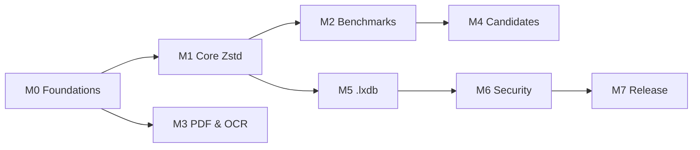

# LEXORA Roadmap

> **Status:** Active — M1 complete, M2 in progress (gate G2), M3–M6 partly landed. Remaining-work sequencing lives in [PATH_TO_V1.md](PATH_TO_V1.md)
> **Owner:** Documentation architect (delegated), project owner Dr. Sohil Momin accountable
> **Last verified:** 2026-11-23 (state reconciliation: every milestone re-read against `main` @ `931aac4`; gate 765 passed / 3 skipped, linkcheck OK)
> **Related:** [PHASES.md](PHASES.md) · [IMPLEMENTATION_PLAN.md](IMPLEMENTATION_PLAN.md) · [SPECIFICATION.md](SPECIFICATION.md) · [PROJECT_CHARTER.md](PROJECT_CHARTER.md)

## Purpose

Milestone-level view of where LEXORA is going and what each milestone must prove before it can be called complete. Detail lives in [PHASES.md](PHASES.md); this file is the summary horizon.

## Scope

Project milestones only. Dates are **not** committed — no schedule was agreed with the owner, so every milestone is sequenced by dependencies, not calendar.

## Status legend

`Not started` · `Planned` · `In progress` · `Blocked` · `In review` · `Complete` · `Deferred` · `Cancelled`

## Milestones

| ID | Milestone | Contents | Exit evidence required | Status |
|---|---|---|---|---|
| **M0** | Foundations | Documentation system (Batches A–E), accepted ADR set, frozen canonicalization rule table + golden vectors, spec `LEXORA-SPEC-1.0-draft` → approved | Docs link-clean; ADR-0001…0004 accepted ✅ *(2026-10-15, delegated)*; rule table frozen with tests; OQ-7 answered | **Complete except owner review** — Batches A–C complete; D–E drafted and on remote since Session 11, **owner review still outstanding**. ADR-0001…0024 accepted. Canonicalization v0 rules (CAN-R01/R02/R05) implemented with 9 golden vectors + an invariant suite; the rule table is deliberately **not** frozen for 0.x (a 0.x release may change what an archive contains — CHANGELOG versioning note) |
| **M1** | Core Zstd baseline | Python package skeleton; TXT ingest → canonicalize → Zstd block encode/decode; byte-exact round-trip property tests; CLI `lxz pack/unpack` (Core only); `.lxz` format v0 frozen | Round-trip tests pass on corpus smoke sample; format test vectors checked in; memory budget respected (≤4 GiB host) | **Complete (owner-accepted S38)** — code/tests landed (S12–S26: package skeleton, canonicalizer+golden vectors+invariants, zstd codec, `.lxz` v0 per ADR-0007, CLI canon/zround/pipe/pack/unpack); evidence closed via P1_EVIDENCE_DRAFT.md (editable install verified; peak RSS 84 MiB vs 512 MiB budget PASS w/ caveats) |
| **M2** | Benchmark harness | Corpus assembly per [CORPUS_POLICY] (≥1 GiB, en/hi/gu), lineage splits 70/10/20, frozen baselines (Zstd-19, Brotli q11, XZ, PPMd per ADR-0002/0003), total-cost accounting, per-category + corpus reports | First real numbers in [BENCHMARK_RESULTS.md]; environment + manifest hashes recorded | **In progress** — corpus met (1.054 GiB); R4/R5 published; R6 protocol-shaped (3 splits, 3 reps, 6 systems, CHCE −18.51 % vs `xz -9`). **G2 still open**: full-corpus scale, second machine class, CLI `xz`, sign-off — [PATH_TO_V1](PATH_TO_V1.md) P0 |
| **M3** | PDF & OCR ingestion | PDF text extraction; optional Tesseract path for scanned pages; page ordering; header/footer dedup rules; confidence-gated corrections (ADR-0004 metric operationalized) | Cleaning error rate measured ≤1% point / ≤2% bootstrap UB on labeled sample; invariant checks green | **In progress** — extraction and OCR landed ([ADR-0017](ADR/ADR-0017-pdf-engine.md) pypdf text layer, [ADR-0019](ADR/ADR-0019-ocr-plugin.md) external Tesseract; provenance per REQ-ING-004; verified on a real 99-page scan). **Exit evidence not met:** the cleaning-error rate (REQ-CAN-007) has never been measured against a human transcript, and header/footer dedup (CAN-R10) is designed, not built — [PATH_TO_V1](PATH_TO_V1.md) P3.5 |
| **M4** | Optional compression candidates | Dictionaries, Re-Pair, bounded token PPM, numeric/record coding, template+residual — each gated by ADR-0001 promotion rule with full serialized cost accounting | Per-category wins ≥10% on validation AND reproduced on held-out for any candidate kept; losers retired with ablation notes | **In progress** — registry and policy landed ([ADR-0014](ADR/ADR-0014-ziptastic-codec.md), [ADR-0015](ADR/ADR-0015-codec-policy.md), [ADR-0021](ADR/ADR-0021-codec-policy-v2.md)); CHCE (ziptastic) is the max-ratio preset, measured −19.75 % smoke and −18.51 % vs `xz -9` at R6 scale; zstd **dictionary mode** landed and a frame needing its dictionary is refused without it. **PPMd withdrawn** — `pyppmd` corrupts 3–8 % of real documents — so OQ-18 is open again. No candidate has passed the ADR-0001 promotion rule at protocol scope |
| **M5** | `.lxdb` repository layer | Multi-document store, index/search, incremental updates, recovery runbook semantics | Recovery tests after simulated corruption; documented format frozen via ADR | **Direction done, no bytes.** Query layer shipped ([ADR-0016](ADR/ADR-0016-queryable-archive.md): SQLite index over `.lxz` blobs) and has since grown tokenizer recording ([ADR-0024](ADR/ADR-0024-tokenizer-recording.md), schema v2→v3) and a `doc_grams` index for short CJK queries; single-file shape + mutation model recorded as [ADR-0013](ADR/ADR-0013-lxdb-layout.md) (**Proposed**, gated on G2) |
| **M6** | Security hardening & optional encryption | Decoder resource limits, fuzzing, threat-model mitigations; AEAD profile behind feature flag if owner keeps encryption in scope | Fuzz campaign with crash triage; security docs reviewed; no unverified claims in README | **In progress** — decoder resource limits documented and enforced ([RESOURCE_LIMITS.md](RESOURCE_LIMITS.md)); reader/writer fuzz suites and an interruption suite run in the gate; threat model, privacy and security architecture docs landed. Encryption stays **Proposed** ([ENCRYPTION_PROFILE.md](ENCRYPTION_PROFILE.md), ADR-0009). **Exit evidence not met:** no fuzz *campaign* with crash triage has been run |
| **M7** | First public release | Versioned package, release process dry-run, migration guide activated, CI green, badges earned for real | Tag + release artifacts exist; CHANGELOG "Unreleased" section empty at cut | **In progress** — two alphas tagged and published (`v0.1.0-alpha.1` 2026-11-09, `v0.2.0-alpha.1` 2026-11-18), artifacts' hashes recorded against the attached files rather than a rebuild, CI green. **Not met:** release-process dry run, badges earned for real, "Unreleased" emptied at cut — and **R5 is still the one unmet release precondition**, which is why both releases are alpha |

## Explicit non-goals on this roadmap

- No claim that LEXORA beats any baseline until M2 produces reproducible evidence.
- No shipping codec other than Zstd unless promoted per ADR-0001.
- Lossless *source/OCR* recovery is out of scope; losslessness applies post-canonicalization only.

## Dependencies between milestones

## Open items gating progress

OQ-5 (license), OQ-6 (repo URL), OQ-7 (Python version), OQ-8 (corpus), OQ-9 (versioning adoption), OQ-10 (OCR stack) — see [DECISIONS.md](DECISIONS.md). OQ-7 blocks M1 code; OQ-8 blocks M2.
