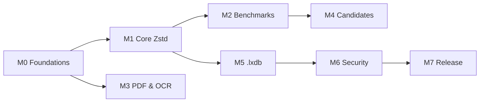

# LEXORA Roadmap

> **Status:** Draft (planning document; no phase complete)
> **Owner:** Documentation architect (delegated), project owner Dr. Sohil Momin accountable
> **Last verified:** 2026-10-15 (documentation-only audit; no code exists yet)
> **Related:** [PHASES.md](PHASES.md) · [IMPLEMENTATION_PLAN.md](IMPLEMENTATION_PLAN.md) · [SPECIFICATION.md](SPECIFICATION.md) · [PROJECT_CHARTER.md](PROJECT_CHARTER.md)

## Purpose

Milestone-level view of where LEXORA is going and what each milestone must prove before it can be called complete. Detail lives in [PHASES.md](PHASES.md); this file is the summary horizon.

## Scope

Project milestones only. Dates are **not** committed — no schedule was agreed with the owner, so every milestone is sequenced by dependencies, not calendar.

## Status legend

`Not started` · `Planned` · `In progress` · `Blocked` · `In review` · `Complete` · `Deferred` · `Cancelled`

## Milestones

| ID | Milestone | Contents | Exit evidence required | Status |
|---|---|---|---|---|
| **M0** | Foundations | Documentation system (Batches A–E), accepted ADR set, frozen canonicalization rule table + golden vectors, spec `LEXORA-SPEC-1.0-draft` → approved | Docs link-clean; ADR-0001…0004 accepted ✅ *(2026-10-15, delegated)*; rule table frozen with tests; OQ-7 answered | **In progress** |
| **M1** | Core Zstd baseline | Python package skeleton; TXT ingest → canonicalize → Zstd block encode/decode; byte-exact round-trip property tests; CLI `lxz pack/unpack` (Core only); `.lxz` format v0 frozen | Round-trip tests pass on corpus smoke sample; format test vectors checked in; memory budget respected (≤4 GiB host) | Not started |
| **M2** | Benchmark harness | Corpus assembly per [CORPUS_POLICY] (≥1 GiB, en/hi/gu), lineage splits 70/10/20, frozen baselines (Zstd-19, Brotli q11, XZ, PPMd per ADR-0002/0003), total-cost accounting, per-category + corpus reports | First real numbers in [BENCHMARK_RESULTS.md]; environment + manifest hashes recorded | Not started |
| **M3** | PDF & OCR ingestion | PDF text extraction; optional Tesseract path for scanned pages; page ordering; header/footer dedup rules; confidence-gated corrections (ADR-0004 metric operationalized) | Cleaning error rate measured ≤1% point / ≤2% bootstrap UB on labeled sample; invariant checks green | Not started |
| **M4** | Optional compression candidates | Dictionaries, Re-Pair, bounded token PPM, numeric/record coding, template+residual — each gated by ADR-0001 promotion rule with full serialized cost accounting | Per-category wins ≥10% on validation AND reproduced on held-out for any candidate kept; losers retired with ablation notes | Not started |
| **M5** | `.lxdb` repository layer | Multi-document store, index/search, incremental updates, recovery runbook semantics | Recovery tests after simulated corruption; documented format frozen via ADR | Not started |
| **M6** | Security hardening & optional encryption | Decoder resource limits, fuzzing, threat-model mitigations; AEAD profile behind feature flag if owner keeps encryption in scope | Fuzz campaign with crash triage; security docs reviewed; no unverified claims in README | Not started |
| **M7** | First public release | Versioned package, release process dry-run, migration guide activated, CI green, badges earned for real | Tag + release artifacts exist; CHANGELOG "Unreleased" section empty at cut | Not started |

## Explicit non-goals on this roadmap

- No claim that LEXORA beats any baseline until M2 produces reproducible evidence.
- No shipping codec other than Zstd unless promoted per ADR-0001.
- Lossless *source/OCR* recovery is out of scope; losslessness applies post-canonicalization only.

## Dependencies between milestones

## Open items gating progress

OQ-5 (license), OQ-6 (repo URL), OQ-7 (Python version), OQ-8 (corpus), OQ-9 (versioning adoption), OQ-10 (OCR stack) — see [DECISIONS.md](DECISIONS.md). OQ-7 blocks M1 code; OQ-8 blocks M2.
